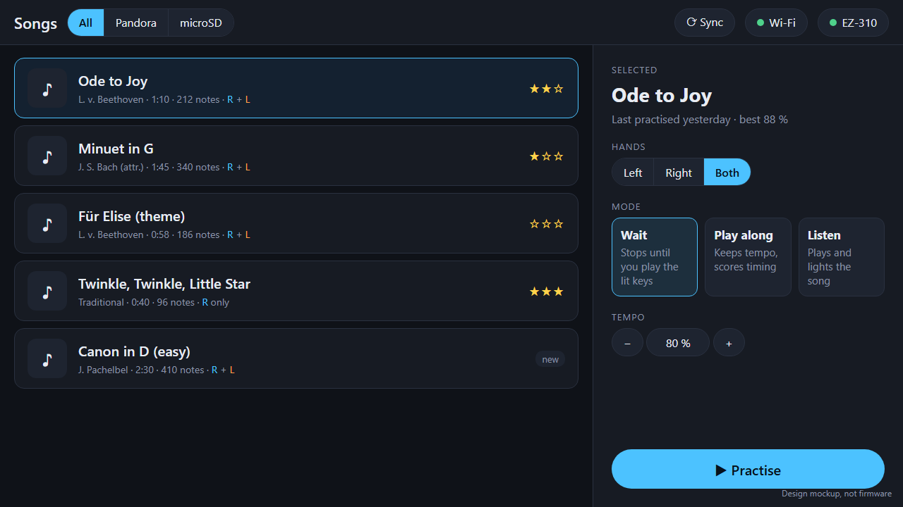
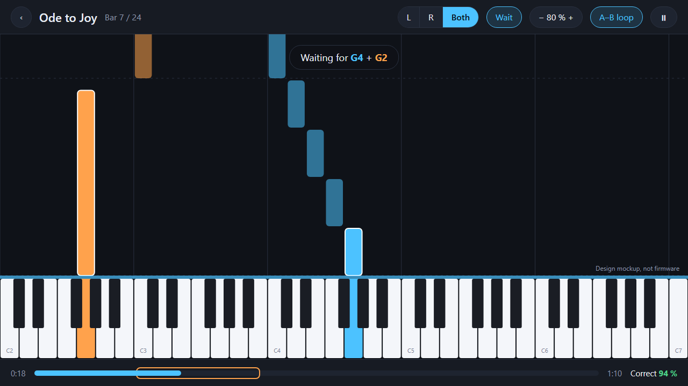
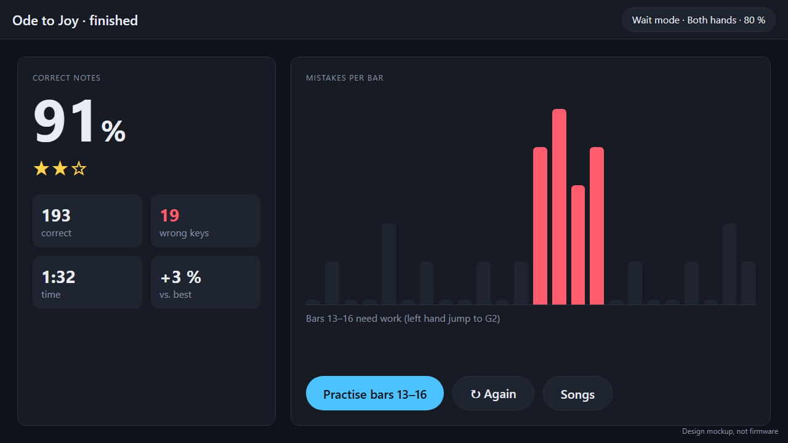

# piano-tutor

A Flowkey-style practice helper for a **Yamaha EZ-310** (lighted keys), running on an
**M5Stack Tab5**. Load a MIDI song, the Tab5 lights the next notes on the keyboard,
waits for the right keys and shows progress on its 5" screen.

| Path | What |
| --- | --- |
| `firmware/` | ESP-IDF app for the Tab5 (ESP32-P4). Now: test firmware that opens the EZ-310 over USB, logs key presses and lights a scale |
| `firmware/components/usb_midi_host/` | USB MIDI in + out on the Tab5 USB-A port (based on M5MusicTab5) |
| `firmware/components/midi_file/` | Standard MIDI File parser (from M5MusicTab5) |
| `docs/hardware.md` | Parts, wiring, EZ-310 settings, known risks |
| `THIRD_PARTY.md` | What came from M5MusicTab5 (MIT) |

Songs come from Pandora (raspberry-projects): send her a YouTube link and she turns it into a
MIDI file with the right hand on channel 1 and the left hand on channel 2. The Tab5 will
download them from `http://homepi.local:8095/songs.json` on the home Wi-Fi.

**Quick test on day one:** flash M5MusicTab5 itself with its web flasher
(https://fangbrbr.github.io/M5MusicTab5/), plug in the EZ-310 and check its USB MIDI icon and
Tiny Piano app react to the keys. That proves USB works before flashing this firmware.

## Hardware

- M5Stack Tab5 Kit K145 (ESP32-P4, 5" 1280x720 touch, NP-F550 battery, microSD), from Reichelt
- USB-A to USB-B cable: Tab5 **USB-A host port** -> EZ-310 USB TO HOST.
  The Tab5 USB-C port is only for charging and flashing; it cannot host the keyboard.
- USB-C charger, microSD card for songs

## Plan

1. **USB bring-up:** Tab5 enumerates the EZ-310 (USB audio + MIDI composite) and logs key presses.
   Riskiest step, done first.
2. **Lights:** send notes on the EZ-310 light channels (Function 042/043, default ch 1/2) and confirm keys light.
3. **Wait mode:** load a MIDI file from microSD, light the next note(s), advance on the correct key.
4. **Screen:** song list, piano roll, tempo, loop a section, left/right hand, score.
5. **Extras:** upload songs over Wi-Fi (separate ESP32-C6, so it can run alongside USB host).

## UI (planned)

> **Design mockups, not screenshots of the firmware.** The tutor UI isn't built yet; the current
> firmware only tests USB MIDI. These show the target layout at the Tab5's 1280x720.
> Source: [`docs/ui/mockups.html`](docs/ui/mockups.html) (re-render instructions at the top of the file).

**Song list:** songs from Pandora (Wi-Fi) and microSD, stars per song, choose hands, mode
(Wait / Play along / Listen) and tempo.



**Practice:** notes fall onto a 61-key keyboard that matches the EZ-310 (C2-C7). Right hand blue
(channel 1), left hand orange (channel 2). The keys lit on screen are the keys lit on the EZ-310. In Wait
mode the song stops until both lit keys are played. Top bar: hands, Wait, tempo, A-B loop; bottom: progress
with the loop region and the score.



**Results:** correct notes, wrong keys, time, mistakes per bar, and a button that loops the worst bars.



### Emulating the Tab5

There is no emulator for the ESP32-P4 or the Tab5 (QEMU and Wokwi don't cover it). The plan is to write
the UI in LVGL with the hardware behind a small interface, so the same UI code also builds for LVGL's PC
simulator (SDL, 1280x720 window). On a PC the simulator can use the EZ-310 through the PC's own USB MIDI,
so most UI and wait-mode work can be done before the Tab5 is involved.

## Setup

One command installs everything (ESP-IDF v5.5.5 for the Tab5, gitleaks, Python) and builds the firmware:

```bash
./scripts/setup-mac.sh                                                  # macOS
powershell -ExecutionPolicy Bypass -File scripts\setup-windows.ps1      # Windows
```

Coding agents: see `CLAUDE.md`.

## Workflow

```bash
git commit -am "..." && git push
```

GitHub Actions builds the firmware for `esp32p4` on every push that touches `firmware/`, so
compile errors show up even without a local toolchain. To flash, install ESP-IDF >= 5.4.2
(see `firmware/README.md`). Older IDF versions and M5Stack's Arduino fork have a Tab5
full-speed USB host bug (m5stack/M5Stack#344).

## Secrets

Nothing secret is committed (future Wi-Fi credentials stay in ignored local files).
Same guards as raspberry-projects: `.gitignore`, a gitleaks pre-commit hook
(`git config core.hooksPath .githooks`, needs gitleaks installed) with rules in
`.gitleaks.toml`, and a gitleaks GitHub Action.

MIDI songs are not committed either (`songs/` is ignored): many are copyrighted.
